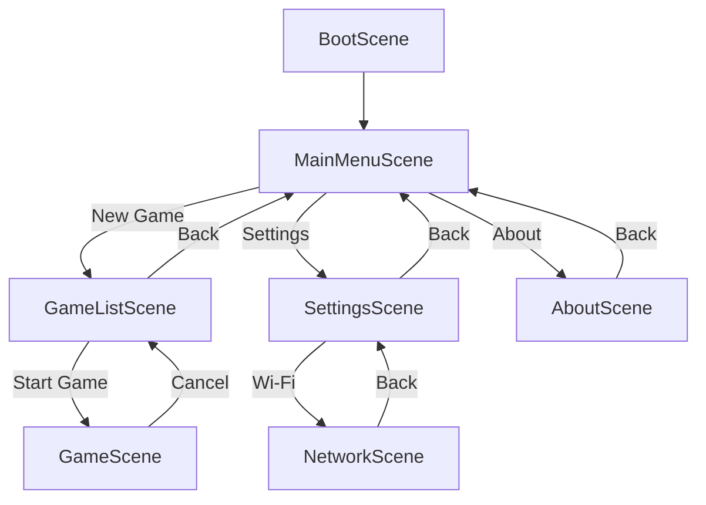
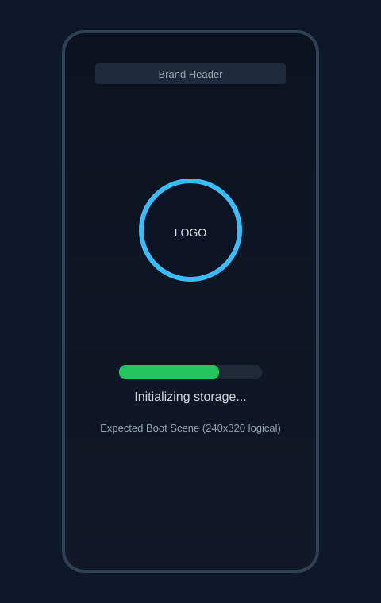
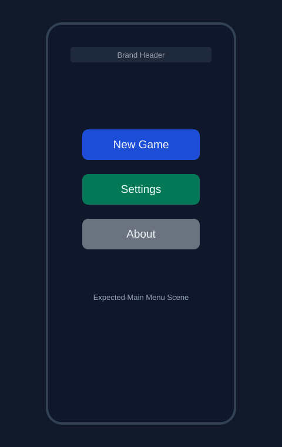
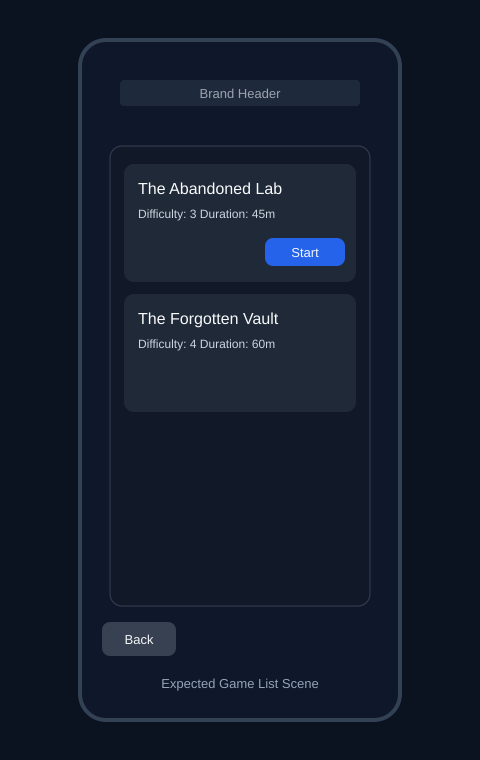
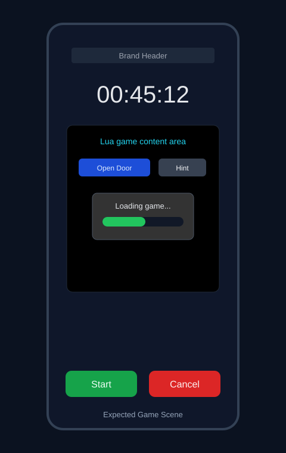
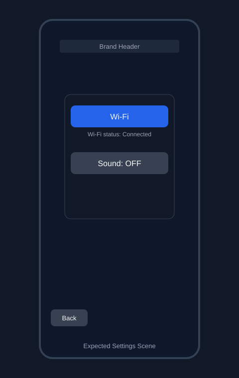
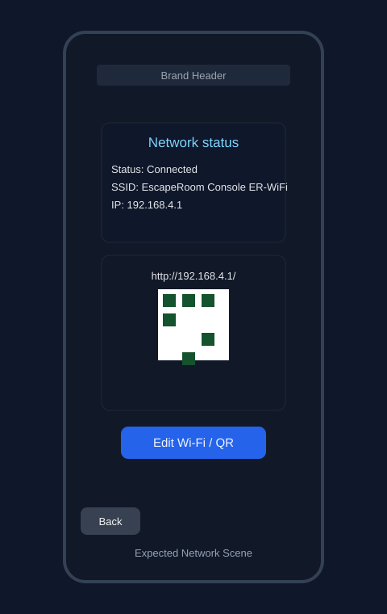
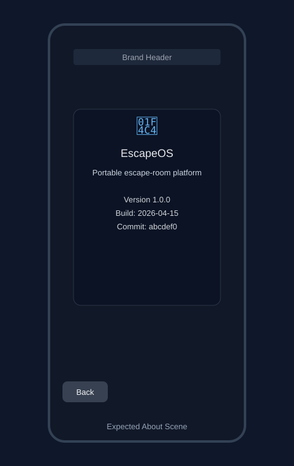
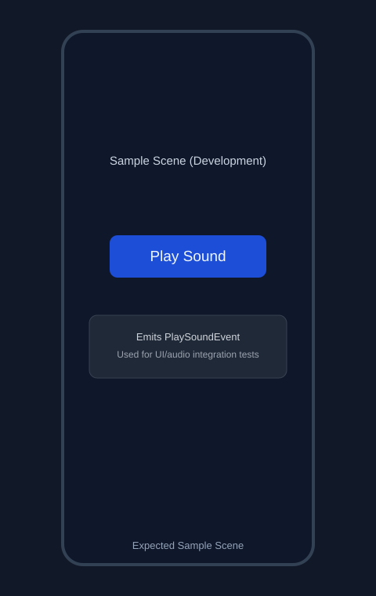

# UI (ESP32 TFT) And Scene Experience

This page documents the on-device TFT user experience (LVGL-based), scene navigation model, and expected visual results.

## Display Profile

- Display driver: LovyanGFX (`Panel_ILI9341`)
- Logical panel size: 240 x 320
- Touch input: XPT2046
- UI framework: LVGL
- Default transition duration: 300ms (`lv_scr_load_anim`)

## Runtime Note (Current Branch)

`UIManager` currently starts with `SampleScene` for development:

- `scenes.changeScene(new SampleScene());`
- `BootScene` startup is present but commented out.

Expected production UX flow is still boot-first, as documented below.

## Scene Flow



## Scene Catalog

| Scene | Purpose | Main Controls | Outgoing Navigation |
| --- | --- | --- | --- |
| BootScene | Startup progress and readiness | Spinner logo, progress bar, status label | Auto -> MainMenuScene when boot complete |
| MainMenuScene | Primary navigation hub | New Game, Settings, About buttons | -> GameListScene / SettingsScene / AboutScene |
| GameListScene | Choose available game package | Scrollable game cards, Start, Back | -> GameScene (selected game), -> MainMenuScene |
| GameScene | In-game runtime surface + Lua content | Start/Pause, Cancel, timer, game content area | -> GameListScene on cancel |
| SettingsScene | Device preferences and status shortcuts | Wi-Fi, Sound toggle, Back | -> NetworkScene, -> MainMenuScene |
| NetworkScene | Wi-Fi state + portal onboarding | Edit Wi-Fi / QR, Back, QR toggle | -> SettingsScene |
| AboutScene | Firmware metadata and version details | Back | -> MainMenuScene |
| SampleScene | Dev test scene (audio event test) | Play Sound | No scene transition |

## Per-Scene UX Details

### BootScene

- Starts in text-only mode until storage is ready.
- Once storage is available, it loads brand + logo images.
- Uses animated spinner on logo and progress bar updates from boot queue events.
- Auto-transitions to main menu after 100% completion and a short delay.

Expected visual:



### MainMenuScene

- Centered vertical action stack.
- Three primary actions: New Game, Settings, About.
- Brand header at top and low cognitive load interaction model.

Expected visual:



### GameListScene

- Scroll list of game cards (title, description, difficulty, duration).
- Tap card to expand/collapse selection details.
- Start action launches selected game, Back returns to menu.

Expected visual:



### GameScene

- Dedicated game content area for Lua-driven drawing/components.
- Timer shown prominently.
- Start/Pause and Cancel controls at bottom.
- Loading card appears while game script is loaded.
- Error label shown if script loading fails.

Expected visual:



Minimal wireframe:

```text
+--------------------------------+
| Brand Header                   |
|                                |
|            00:45:12            |
|                                |
| [ Lua game content area      ] |
| [ text, rects, buttons, etc. ] |
|                                |
| [ Start/Pause ]   [ Cancel ]   |
+--------------------------------+
```

### SettingsScene

- Compact card with Wi-Fi and sound controls.
- Live Wi-Fi status text refresh from `NetworkSystem`.
- Sound toggle updates button label (ON/OFF).

Expected visual:



### NetworkScene

- Split between status card and portal card.
- Shows current network state, SSID, IP.
- Displays portal URL and toggles QR code overlay for onboarding.

Expected visual:



### AboutScene

- Static informational screen with firmware version/build/commit.
- Text color indicates dev mode when enabled.

Expected visual:



### SampleScene

- Development/test screen used to validate event-driven UI flow.
- Contains a single "Play Sound" button.
- Emits `PlaySoundEvent` consumed by `SampleScene` and forwarded to audio queue.

Expected visual:



## Interaction Model

- Views emit typed UI events (for example `ButtonClickedEvent`).
- Scenes consume events and produce `SceneRequest` values.
- `SceneManager` performs scene changes and transition animations.

## UX Implementation References

- Scene contracts and navigation enums: `src/systems/ui/Scene.h`
- Scene routing logic: `src/systems/ui/SceneManager.cpp`
- Current startup scene selection: `src/systems/ui/UIManager.cpp`
- Boot view: `src/scenes/boot/BootView.cpp`
- Main menu view: `src/scenes/menu/MainMenuView.cpp`
- Game list view: `src/scenes/gamelist/GameListView.cpp`
- Game view: `src/scenes/game/GameView.cpp`
- Settings view: `src/scenes/settings/SettingsView.cpp`
- Network view: `src/scenes/network/NetworkView.cpp`
- About view: `src/scenes/about/AboutView.cpp`
- Sample view: `src/scenes/sample/SampleView.cpp`

## Publishing Tip

When copying wiki pages to `<repo>.wiki.git`, include the `images/` folder so embedded scene visuals render correctly.
